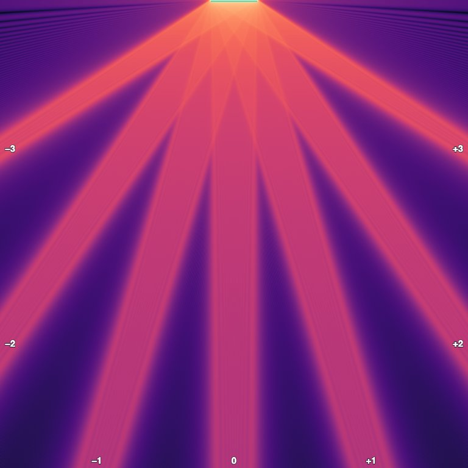
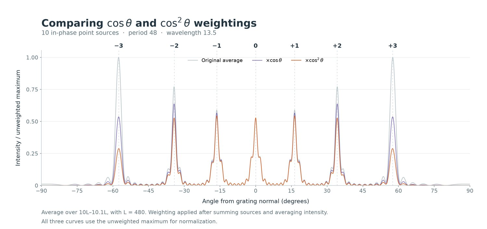
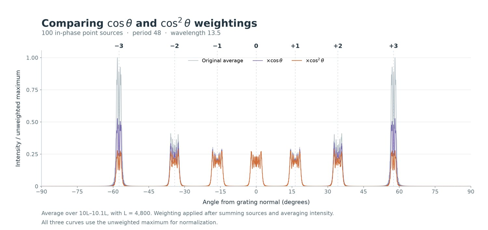

# Grating Explorer

A local-first diffraction explorer for a finite, coherent line of point sources. Open the [app](https://nicolas-wyler.github.io/grating-explorer/) in Chrome; use Chrome’s **Install** button to add an app window and icon. Version **1.3.3** is shown inside the app.

The first visit needs an internet connection to download the app and its scientific runtime. Wait until the app says **Ready offline**. After that, calculations and saved results work offline. When a newer version is published, the installed app checks for it when online and activates it automatically; an active calculation is allowed to finish and save before the window reloads. Existing results stay in browser storage across updates.

## Use

1. Enter a pitch, wavelength and number of periods. Pitch and wavelength must use the same length unit. One source is placed at each period center; the reference length is L = number of periods × pitch.
2. Set the square viewer side in multiples of L and the resolution in pixels per side. The grating is centered at the top, and propagation is downward. Choose **Calculate heatmap**. The progress bar shows elapsed and estimated remaining time; an estimate is also shown before running.
3. Choose intensity, amplitude or wrapped phase. Intensity and amplitude have linear and logarithmic scales. The linear ceiling is a percentage of the maximum of the current quantity in the current view. Drag a square region and choose **Calculate selection** to recompute it more finely; switch back with **Overview**.
4. To obtain angular curves, choose a starting radius and annulus width and press **Calculate angular plot** separately. The plotted curves are the area-averaged intensity, that intensity multiplied by cos θ and by cos² θ. Use the buttons to download the plot or CSV.
5. **Browse history** reopens completed runs. The app reuses a compatible result when its settings and sampling are sufficient, saves every completed overview, detail region and angular result, and restores the last session on restart. Use **Export library** to download a backup and **Import backup** to merge it into a library without overwriting existing results. A backup from the companion Mac app can also be imported.

## Model and limitations

The complex field is the sum of identical in-phase scalar spherical waves, U = Σ exp(ikr)/r. There is one point source per pitch, but the first-to-last span is (N−1) pitches. This model has no slit-width envelope, material, polarization or multiple scattering; it is not a quantitative electromagnetic efficiency calculation. The cosine curves are weights applied **after** adding the fields and averaging the intensity, not per-source obliquity factors. Order labels indicate normal-incidence geometric directions and do not promise a local near-field maximum.

The app resolves the wavelength on an internal grid, averages values over each output pixel, and optionally smooths residual subpixel structure. Phase is a circular average; low-coherence or excluded pixels are gray. The source-plane cutoff, samples per wavelength, smoothing, phase reliability threshold, log range, and annular sampling can be adjusted under **Calculation details & aliasing**. True phase zeros and structures finer than the displayed pixels cannot be guaranteed free of ambiguity; inspect a smaller region and compare finer sampling when it matters.

The saved numerical grids are lossless at the selected output resolution; the much larger intermediate wavelength-resolved grid is not retained. Reuse requires matching source geometry, region, filter and cutoff and at least the requested sampling and output resolution. Compatible higher-resolution heatmaps retain their actual resolution. Runtime estimates are approximate and improve after comparable calculations. A computation interrupted before saving has to be restarted.

Data is stored on the device in this browser’s site storage; another browser, device, or the standalone Mac app has a separate library. Clearing site data can erase results, so export a backup for anything important. The storage indicator reports library size and browser storage remaining. The app asks the browser for persistent storage, subject to the browser’s policy. Import merges saved runs and ignores duplicates; it does not replace current settings. Browser imports accept up to 1 GiB of uncompressed data per backup.

## Development

The static app is served by GitHub Pages. Calculations run in a web worker using [Pyodide](https://pyodide.org/) 0.29.4, NumPy, SciPy, Matplotlib and Pillow. The code and offline cache are separate from the saved-result library. To release an update, change the version in the app and `sw.js`, then publish the changed files. The new service worker precaches the app and keeps the scientific runtime cached for offline use. Start a local test with `python3 -m http.server`; a secure context (HTTPS or localhost) is required for service workers.

The companion macOS 1.2.0 package uses the same numerical model but relies on a locally installed Python and its dependencies. It is distributed separately from this PWA and does not update automatically.

## Examples

100 point sources, pitch 48, wavelength 13.5; a 10L-square overview with geometric order labels.

Ten sources, pitch 48, wavelength 13.5, averaged between radii 10L and 10.1L.

The same angular comparison for 100 sources. These are illustrative scalar-model results, not measured efficiencies.
